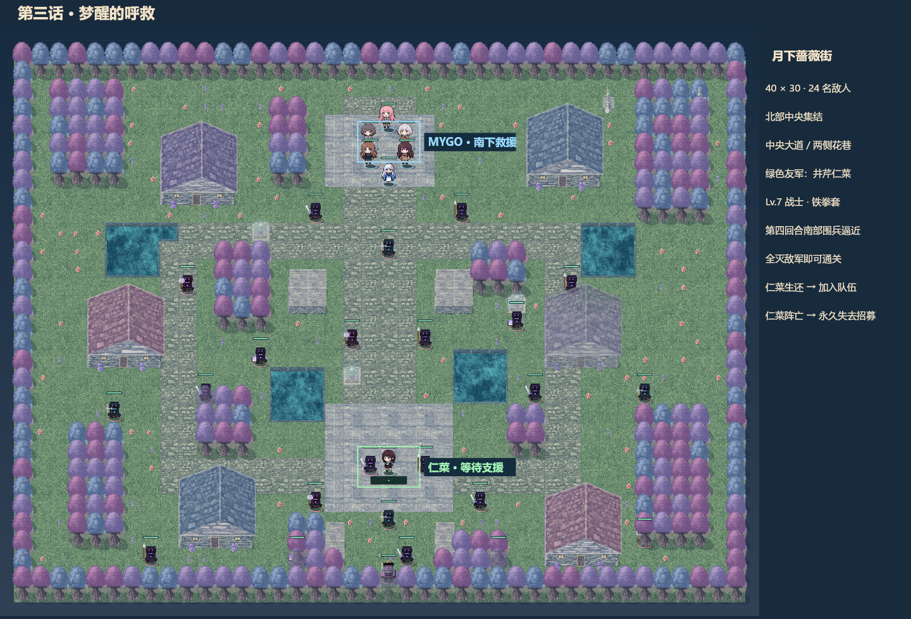

# 第三话 · 梦醒的呼救

第三关位于「月下蔷薇街」，延续第二关的粉紫花树、银蓝月光、浅色石路、纹理屋舍和方格 2.5D 场景。地图为 40×30，共 24 名敌人。布局与目标独立设计：北部中央的 MyGO 向南推进，解救南部中央被怪物包围的井芹仁菜，最终消灭全部敌人。

## 入口与章节继承

- 标题页选择「第三重 · 梦醒的呼救」。也可用 `index.html?stage=3`，在标题页开始游戏。
- 第二关胜利后点击「进入第三章」，继承背包、武器耐久、运输队、等级、经验与成长记录。此前已招募的雪月随队出战。
- 普通版和 `standalone.html` 使用同一套规则。标题页直接进入第三关用于独立游玩；连续章节的继承入口位于第二关胜利界面。

## 地图与救援节奏

我方初始位于 x=19～21、y=3～6，仁菜初始位于 (20,22)。中央大道通向救援广场，两侧花巷可绕过中央敌人；池塘、六座房舍、林地和三处回复据点构成通路与掩护。怪物分为中央、西侧、东侧、初始围攻与南侧警戒组。

仁菜身边的三名敌人从开局围攻。其他巡逻组优先迎击赶来的玩家部队，避免全图怪物立即集中攻击仁菜。第四回合开始，南侧围兵主动逼近。关卡没有固定回合失败限制；需要在压力增加前赶到并治疗或清理围攻敌人。

五个固定随机种子的无玩家干预模拟均验证：仁菜能存活前三轮；持续放任会在第五至第六轮阵亡。该结果用于防止救援窗口过短，不保证每种行动与随机结果下的生存时间相同。

## 仁菜与友军规则

仁菜为 **Lv.7 战士，装备铁拳套**。她在现实世界睡着后，睁眼发现身处陌生世界、被怪物包围；挥拳抵抗时看见正在赶来的 MyGO。介绍、角色档案和招募对话均采用这一背景。

关卡期间，她属于绿色友军阵营，玩家可以查看情报，不能选择她移动、战斗或整理背包。每轮顺序为「我方 → 友军 → 敌军」，她会自主攻击周围四格内已警戒的敌人，没有附近目标时等待。玩家能穿过友军格，但不能在其所在格结束移动；双方不能互攻。玩家的辅助治疗可以治疗她，已阵亡时无法复活。

铁拳套射程 1，主动攻击按「首击 → 连击 → 敌方反击 → 满足攻速条件时追击与连击」结算。拳套反击为一次，逐击扣除耐久，任一方倒下立即中断。演出使用拳击、连拳和暴击踢击动作。

用户指定了等级、职业和武器。其余初始属性为本关的暂定设计值；个人成长率已按 2026-11-13 更新的《角色成长值.xlsx》导入：

| 属性 | HP | 力量 | 魔力 | 技巧 | 速度 | 幸运 | 防守 | 魔防 | 移动 |
| --- | --- | --- | --- | --- | --- | --- | --- | --- | --- |
| 初始值 | 36 | 12 | 2 | 10 | 10 | 7 | 8 | 3 | 4 |
| 个人成长率 | 45% | 50% | 20% | 50% | 45% | 35% | 30% | 25% | — |

个人成长叠加现职业修正；战士实际成长依次为 55%、55%、20%、50%、45%、35%、30%、20%。作为 NPC 时不获得玩家经验，招募后接入同伴成长规则。七人个人成长统一保存在 `growth-data.js`，升级进度随存档保留；全部角色采用最新 Excel 表格中的个人成长率，详见 [成长系统说明](GROWTH.md)。

## 胜利、阵亡与存档

- 胜利条件是消灭全部敌人，不能仅击败首领。
- 仁菜生还时，胜利结算将她加入「同行之人」，播放相遇与招募演出；保留当前 HP 与背包耐久。
- 仁菜阵亡不直接导致任务失败。该流程的存档写入 `ninaLost`，中途或通关读档均不会复活她、播放招募或补发同伴。此处“永久”作用于该局及其后续存档；重新开始关卡属于新的一局。
- 我方可操控角色全灭仍然失败，即使仁菜尚在场。
- 存档保存地图版本、友军状态、招募资格、演出是否已观看和随机状态。友军或敌军阶段的快照恢复至我方阶段，与原有存档恢复策略一致。

## 素材和验证

四张用户提供的原图均已接入：战斗动作、四方向行走、四方向站立、头像及角色立绘。原件与可复现的处理步骤见 [仁菜素材说明](../assets/characters/actions/NINA.md)。地图复用第二关已有纹理与授权体系，见 [月光庭园素材署名](../assets/terrain/moon-dream/README.md)。

`node tests/test-third-chapter.js` 覆盖 16 项，包括阵营、地图连通、NPC 行动、治疗、拳套、救援窗口、永久失去招募、跨章继承、存档、真实 UI 回合调度及招募防重复。其余既有测试继续运行。

`tools/render-third-preview.js` 使用实际 Renderer、Characters 与 BattleScene 在离线 Canvas 中渲染，检查 1,200 格投影拾取、仁菜角色上半身拾取及全部 49 帧动作。它输出部署图、说明图和战斗预览，不代表完成了浏览器全界面人工测试。

